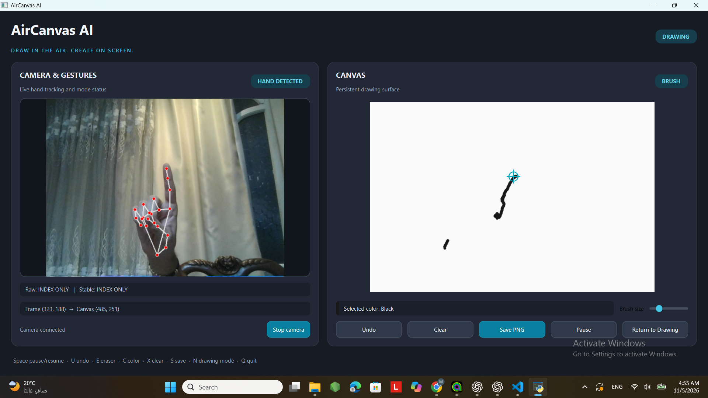

# AirCanvas AI

> **Project status: In progress.** Core drawing and gesture controls are under active development; camera behavior still needs testing on the target computer.

AirCanvas AI is a local desktop drawing app. MediaPipe tracks one hand from the webcam, and OpenCV maintains a persistent canvas. Webcam frames are processed locally; the app does not record or upload them. AI sketch enhancement is not part of this version.

## Requirements and setup

Use 64-bit Python 3.10 or newer on Windows. PySide6 6.11 requires Python 3.10 or newer. Create and activate a project virtual environment in PowerShell:

```powershell
py -3.10 -m venv .venv
.\.venv\Scripts\Activate.ps1
python -m pip install --upgrade pip
python -m pip install -r requirements.txt
```

Run the application from the project directory:

```powershell
python app.py
```

To run the hardware-independent tests:

```powershell
python -m pytest -v
```

## Interface

The app opens one resizable window with a live camera and landmark preview on the left and a light persistent drawing canvas on the right. The camera worker handles capture and hand inference away from the UI thread. The drawing engine remains separate and owns stroke interpolation, erasing, undo, clear, and PNG saving.

Use **Start camera** to connect. The preview shows camera status, raw and stable gesture labels, and fingertip coordinates mapped from the mirrored frame into canvas coordinates. The canvas shows a fingertip cursor. Choose a palette color, adjust brush size, and use Undo, Clear, Save PNG, Pause, or Return to Drawing controls.

## Gesture controls

| Gesture | Action |
| --- | --- |
| Index extended; other fingers folded | Draw |
| Peace sign | Toggle DRAWING / PAUSED; ends the current stroke |
| Closed fist | Enter NAVIGATION mode |
| Pinky only | Open or close the color palette |
| Pinch while the palette is open | Select a palette color based on horizontal position |
| Thumbs up | Undo the most recent stroke |
| Open palm | Toggle brush / eraser |
| Index and pinky | Request canvas clear; confirm or cancel in the dialog |

Command gestures activate once per hold. Release to neutral before repeating. The fist enters navigation; use **Return to Drawing** or press **N** to leave it. Clear requests time out after five seconds.

## Keyboard shortcuts

**Space** pause/resume, **U** undo, **E** toggle eraser, **C** cycle color, **X** request confirmed clear, **S** save PNG, **N** return to DRAWING mode, and **Q/Esc** quit. The on-screen buttons provide the same primary actions.

Drawings are saved as timestamped PNG files under `output/`.

## Troubleshooting and limitations

- If the camera cannot connect, check Windows camera privacy settings and close other apps using it.
- Keep the hand fully visible and reasonably upright. Occlusion, low light, and steep hand rotation can reduce landmark accuracy.
- If gestures are inconsistent, use the visible buttons and keyboard shortcuts; no gesture is required to pause, return to drawing, undo, clear, or save.
- The camera is started only when requested and is released when stopped or when the window closes.
- Verify camera behavior and gesture comfort on the target laptop; unit tests do not require a webcam.

## Screenshot



